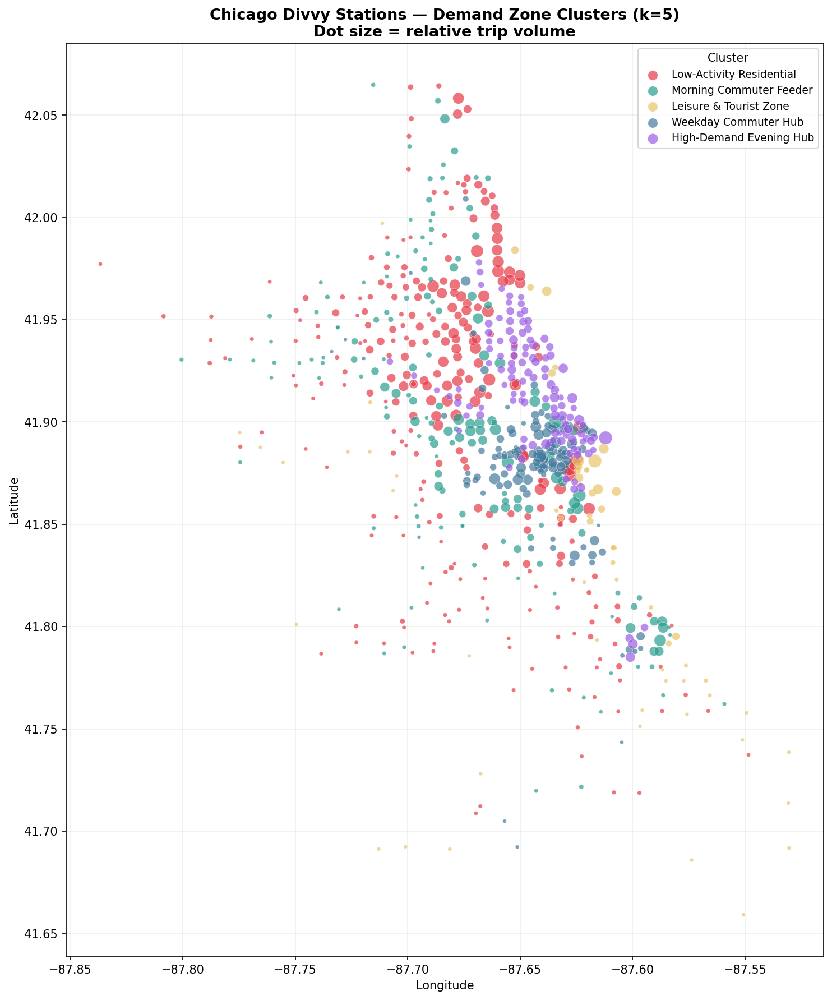
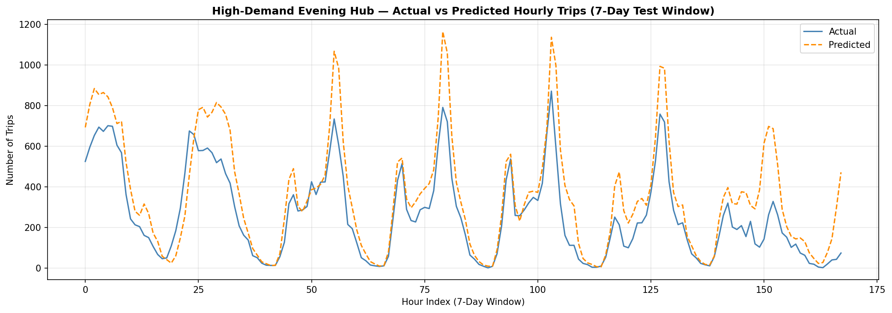
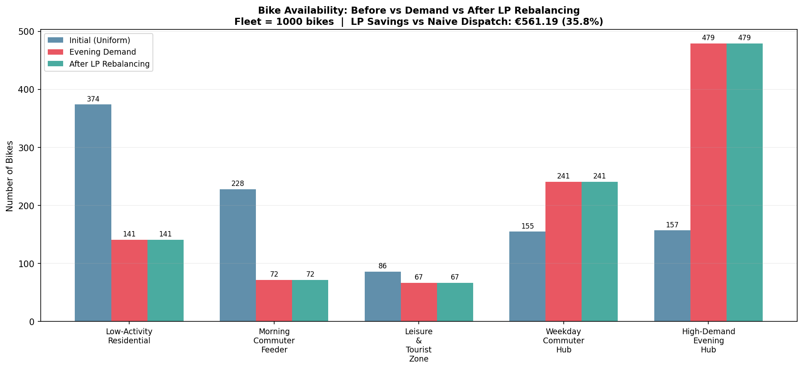

# Fleet Intelligence — bike-share demand forecasting and rebalancing

Shared bikes end up in the wrong place: every evening the busy hubs run empty while
residential areas fill up with idle bikes. This project goes from **1.92 million raw
trips** to a concrete, costed rebalancing plan, in three steps:
**describe** (clustering) → **predict** (forecasting) → **prescribe** (optimisation).

## Results

| Step | Method | Result |
|---|---|---|
| Clean | pandas | 1.92M trips → 1.6M reliable station trips, 724 stations |
| Describe | K-Means on 6 station features (elbow + silhouette) | 5 demand zones; the evening hub is only 114 stations but has the highest daily demand |
| Predict | Linear Regression vs Random Forest, chronological 80/20 split | MAE 266 → **133 trips/hour (−50%)** |
| Prescribe | Linear programming (`scipy.optimize.linprog`) on centroid distances | 408 vehicles moved per shift at **35.8% lower cost** (€1,008 vs €1,570 naive) |





## How it works

| Script | What it does |
|---|---|
| `01_explore.py` | loads the trip files, cleans them (missing coordinates, bad durations), adds time features |
| `02_clustering.py` | builds 6 features per station (volume, duration, weekend share, member share, morning and evening peak), scales them, picks k with elbow + silhouette, runs K-Means |
| `03_forecasting.py` | hourly trips for the evening-hub cluster; trains a linear baseline and a Random Forest on the past and tests on the future (no data leakage) |
| `04_optimization.py` | haversine distance matrix between zones, then a linear program that moves surplus bikes to deficit zones at minimum cost (€0.75 per km per bike), compared with naive dispatch |

Outputs go to `output/` (CSV) and `charts/` (PNG). The two large cleaned CSVs are not in
the repo; `01_explore.py` recreates them.

## Run it

```bash
pip install -r requirements.txt
# download the 4 trip files (see Data) into data/
python 01_explore.py
python 02_clustering.py
python 03_forecasting.py
python 04_optimization.py
```

## Data

Chicago Divvy bike-share trips, 2023: January, April, July and October (one month per
season). Download `202301`, `202304`, `202307` and `202310-divvy-tripdata.zip` from
<https://divvy-tripdata.s3.amazonaws.com/index.html> and unzip the CSVs into `data/`.
Data provided by Lyft Bikes and Scooters under the
[Divvy Data License Agreement](https://divvybikes.com/data-license-agreement).

## Limits

- Divvy is a docked system; many European fleets are dockless. The method transfers, the
  exact numbers would need to be re-fitted per city.
- Distances are straight-line (haversine) between zone centres, not road distances.
- The cost per km is an assumption, so the saving in euros is an estimate; the
  percentage saving is the more robust number.
